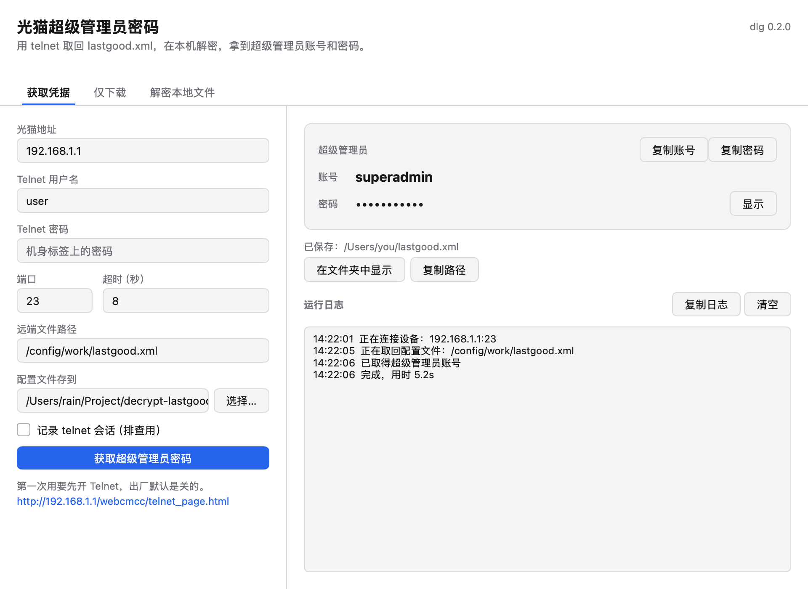

# decrypt-lastgood

通过 telnet 从九联 `UNG953H1-S` 光猫取回 `lastgood.xml`，在本地解密，拿到超级管理员
账号和密码。改桥接、关 TR-069 用得上。单个静态二进制，不用装运行环境。

[](https://go.dev)
[](LICENSE)
[](#技术取舍)
[](#安装)

> Go 重写版。原始实现是 [joestar817/decrypt-lastgood](https://github.com/joestar817/decrypt-lastgood)。

> [!IMPORTANT]
> **先开 Telnet，不然一定失败。** 光猫出厂默认关着它，不开的话只会拿到
> `connection refused`。用机身标签上的普通账号登录
> <http://192.168.1.1/webcmcc/telnet_page.html>，打开开关并保存，再往下看。
> 详见[第一步：开启 Telnet](#第一步开启-telnet)。

## 背景

光猫后台只给普通账号，改桥接要用的超级管理员密码一般已被 TR-069 刷成随机值。九联这台
机器的超密存在 `/config/work/lastgood.xml`，新版固件又给文件加了密，`cat` 出来是二进制。
手工走 telnet、`base64`、本地解密太麻烦，所以有了这个工具。

## 特性

- 一条命令拿到超管账号密码：下载、解密、提取一次完成
- 也有桌面客户端：原生窗口，填地址点一下就行，不用记参数（[见下](#桌面客户端)）
- 命令行不链接任何第三方代码，PBKDF2 和 telnet 客户端都是标准库写的
- 编出来是单个文件，Windows 上只用系统自带的 `kernel32.dll`
- `decrypt --show-cred`（或默认命令）直接把账号密码打出来，不用自己 grep XML
- 对光猫只跑 `echo`、`wc -c`、`base64` 这类只读命令，不改配置
- 下载后拿 `wc -c` 的字节数校验一遍
- Windows（x64 / ARM64）、macOS、Linux 都有

## 第一步：开启 Telnet

光猫出厂把 telnet 关着，这一步不做，后面的命令都会以 `connection refused` 结束。

1. 浏览器打开 **<http://192.168.1.1/webcmcc/telnet_page.html>**（地址换成你的光猫 IP）
2. 用机身标签上的普通账号（通常是 `user`）登录
3. 页面上是「Telnet 设置」，把开关打开，点保存
4. 回到终端，确认端口通了：`nc -z <光猫IP> 23`（Windows 用 `Test-NetConnection <IP> -Port 23`）

连不上时程序会直接把上面这个网址打出来，点一下就能跳到那个页面。

V1.0.03 部分地区的固件这个开关点了也不生效，属于固件限制，跟工具无关。用完记得把它关掉，
23 端口是明文调试通道。

## 安装

从 [Releases](../../releases) 下载对应平台的压缩包，解压即用：

| 平台 | 压缩包 |
| --- | --- |
| Windows x64 | `dlg_<版本>_windows_amd64.zip` |
| Windows ARM64 | `dlg_<版本>_windows_arm64.zip` |
| macOS Apple Silicon | `dlg_<版本>_darwin_arm64.zip` |
| macOS Intel | `dlg_<版本>_darwin_amd64.zip` |
| Linux x64 | `dlg_<版本>_linux_amd64.zip` |

包里是二进制、README 和 LICENSE。macOS 和 Linux 解压后如果提示权限不足，`chmod +x` 一下。

窗口版是另一个包，`dlg_gui_<版本>_<os>_<arch>.zip`（macOS 里是 `.app` 和 dmg，Windows 是
`.exe`，Linux 是可执行文件和安装包），见[桌面客户端](#桌面客户端)。

需要自己编的话，Go 1.27.3 以上（`go.mod` 里写的版本，窗口版用的 MyGo 要求的），不需要 cgo：

```bash
go build -trimpath -ldflags "-s -w" -o dlg ./cmd/dlg
./build.sh    # 全平台，输出到 dist/
```

## 桌面客户端

不想记参数就用窗口版。同一个仓库的 `gui/`，界面由 Go 原生绘制（Metal / Direct3D 11 /
OpenGL），没有 webview，也不用装浏览器运行时，打开就是界面。



三个标签对应命令行的三条路径：**获取凭据**（下载 + 解密 + 显示账号密码）、**仅下载**、
**解密本地文件**。右边是账号卡片和运行日志，密码默认打码，账号、密码、路径都能一键复制；
连不上 telnet 时直接给「打开开启 Telnet 的页面」的链接。勾上「记录 telnet 会话」就等于
命令行的 `-v`。

自己打包（同一条命令，产物在 `gui/build/<os>-<arch>/`）：

```bash
./build-gui.sh                 # 当前平台
cd gui && go run .             # 开发时直接跑
```

细节、架构和已知限制见 [docs/GUI.md](docs/GUI.md)。

## 用法

一条命令就够了，下载、解密、提取三件事一次做完：

```bash
dlg 192.168.1.1 -u user -p '机身标签上的密码'
```

```
超级管理员账号：CMCCAdmin
超级管理员密码：xxxxxxxxxxxx

配置文件：/home/you/lastgood.xml
```

解密后的 XML 默认写到当前目录的 `lastgood.xml`，用 `-o` 换位置。不带子命令、直接给地址，
走的就是这条路径。

参数（默认命令与 `download` 通用）：

| 参数 | 说明 | 默认值 |
| --- | --- | --- |
| `-u` | telnet 用户名，必填 | — |
| `-p` | telnet 密码，省略则交互输入且不回显 | 交互输入 |
| `-P` | telnet 端口 | `23` |
| `-r` | 远端文件路径 | `/config/work/lastgood.xml` |
| `-t` | 连接超时（秒） | `8` |
| `-o` | 输出文件：默认命令写解密后的 XML，`download` 写加密文件 | `lastgood.xml` / `lastgood.xml.enc` |
| `-v` | 输出完整 telnet 会话记录（排查用） | 关闭 |

想分步来、或者手头已经有加密文件时，两个子命令也都还在：

```bash
dlg download 192.168.1.1 -u user -p '机身标签上的密码'   # 只取回 lastgood.xml.enc
dlg decrypt lastgood.xml.enc --show-cred                # 解密并打印账号密码
```

`decrypt` 参数：`-o` 指定输出文件（默认 `lastgood.xml`），`--show-cred` 打印超管账号密码。

主机地址写在参数前或后都行。退出码：成功 `0`，运行时出错 `1`，参数用错 `2`。

## 排查

先加 `-v` 再跑一次，它会把整段 telnet 会话（发出去的命令、收到的原始字节）打到 stderr，
大部分问题看一眼就知道卡在哪。

| 现象 | 原因 |
| --- | --- |
| `connection refused` | 设备上 telnet 没开，去 <http://192.168.1.1/webcmcc/telnet_page.html> 打开并保存 |
| 连接成功但立刻断开、没有任何回显 | 开了 VPN / 代理的 TUN 模式（路由走 `198.18.0.0/15`），把 `192.168.1.1` 设成直连，否则拿到的是代理的假连接 |
| `telnet login did not reach a shell` | 账号密码不对，或该固件 telnet 只是个受限 CLI（不是 BusyBox shell） |
| `does not provide a usable base64` | 设备没有 base64 也没有 busybox applet，把 `-v` 的会话记录贴出来 |
| `downloaded size mismatch` | 传输过程中混进了别的内容，同样需要 `-v` 的会话记录 |

## 工作原理

用普通账号 telnet 登录，先跑 `echo aGk= | base64 -d` 确认设备能解码，再用 `wc -c` 量大小、
`base64` 把文件带回来，按字节数校验。然后三层密钥逐级解包、按 1040 字节分块 AES-CBC 解密，
最后从 tar.gz 里取出 XML，读 `aucTeleAccountName` 和 `aucTeleAccountPassword`。

客户端要自己处理 telnet 选项协商，否则对端可能一直重试把连接卡住。

格式细节见 [docs/FORMAT.md](docs/FORMAT.md)。

## 测试

```bash
go test ./...
go test -race ./...
```

覆盖容器往返解密（含多分块）、各类畸形输入、telnet IAC 协商与跨包分片、仿真 telnet 服务器
（回显、慢速、输出与提示符粘连）、CLI 参数解析与默认命令。

桌面客户端的视图测试不用开窗口，也不会连光猫：

```bash
cd gui
go test ./...
go tool mygo vet .
```

不接光猫也能验证二进制：

```bash
DLG_FIXTURE_OUT=/tmp/fixture.enc go test ./internal/container -run TestWriteFixture
./dlg decrypt /tmp/fixture.enc --show-cred
```

## 兼容性

| 项目 | 状态 |
| --- | --- |
| 九联 `UNG953H1-S` | 开发和测试用的就是它 |
| 九联 `UNG953H-S` | 同系列，格式可能一样，没实测 |
| 其他厂商光猫 | 格式不同，用不了 |

V1.0.02 验证过。V1.0.03 有些批次开不了 telnet，跟工具本身无关。

## 与上游 Python 版的差异

同格式的独立实现，不是逐行翻译。

| 维度 | 上游 | 本项目 |
| --- | --- | --- |
| 运行环境 | Python 3.10–3.12 | 无，单个静态二进制 |
| 依赖 | `cryptography`、`telnetlib` | 无，两个都自己写 |
| 输出超密 | 手工 grep XML | `--show-cred` |
| 密码回显 | `getpass` | `SetConsoleMode` / `stty` |

容器解析、PBKDF2 参数、分块大小、远端只读命令、字节数校验都和上游保持一致。

## 技术取舍

PBKDF2 在 `golang.org/x/crypto` 里有现成的，但引它进命令行的导入图，「单个静态二进制、
不带运行环境」就没了。算法本身五十行左右，还能拿公开测试向量逐条对，自己写更好验证。telnet
同理，`telnetlib3` 是异步框架，而我只要「登录、跑三条命令、读回结果」，用它有点杀鸡用牛刀。

不支持别的厂商，是因为各家容器格式不一样，有用 ZIP 的，有另加一层密钥的。没有实机验证
就去做通用适配，最后只会给出一堆跑不通的承诺。

窗口那一侧反过来：界面得自己画，MyGo 不依赖 webview，一个 Go 程序就是整个应用，和「单文件、
不装运行环境」这条线是一致的。它现在是同一个 module 里的一个包（`gui`），`go.mod` 里因此有
`require github.com/egoist/mygo`——但命令行的导入图里没有它，`dlg` 编出来还是 3.0 MB 的
独立二进制，CI 有一条检查盯着这件事。共用逻辑在 `pkg/dlg`，两边谁也没为对方将就。

一个 module 的代价是工具链：整个仓库跟着 MyGo 要 Go 1.27.3 以上，只编命令行也一样。

## 延伸阅读

- [docs/FORMAT.md](docs/FORMAT.md)：容器格式规范
- [docs/GUI.md](docs/GUI.md)：桌面客户端的界面、架构与打包
- [docs/case-study-first-hop-packet-loss.md](docs/case-study-first-hop-packet-loss.md)：
  这工具的由来，一个用 ping 网关区分 CPU 过载和链路误码的案例

## 致谢与许可

格式的逆向工作来自 [joestar817/decrypt-lastgood](https://github.com/joestar817/decrypt-lastgood)，
恩山论坛（right.com.cn）的讨论提供了不少固件行为上的参考。本项目以
[MIT License](LICENSE) 发布。

上游没声明开源许可证。这边是基于公开逆向结论的独立实现，没有复制它的源代码；如果上游
之后补了许可证，以更严格的为准。

## 免责声明

只用于自己拥有或有权使用的设备。光猫一般是运营商资产，自己改可能影响保修和售后主张。
改桥接前记下 LOID、上网 VLAN ID 和宽带账号密码，不然断了网可能回不去。别用在没授权
的设备上。
