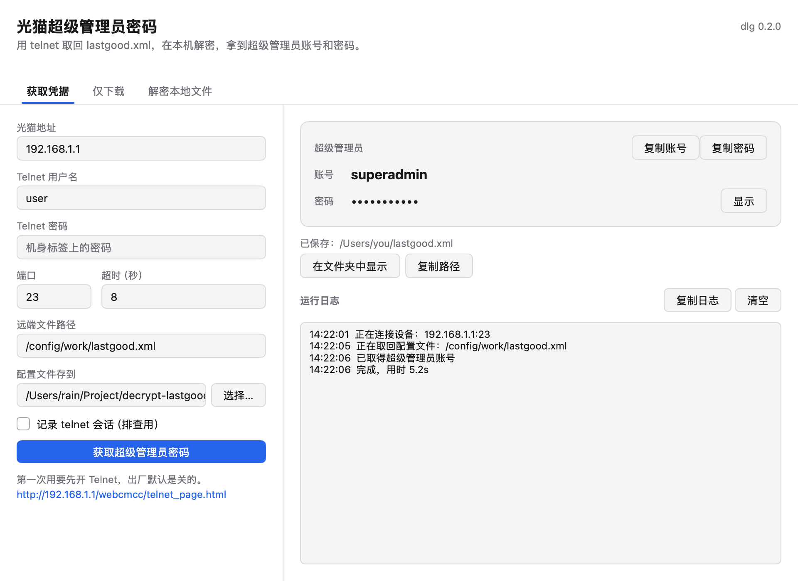
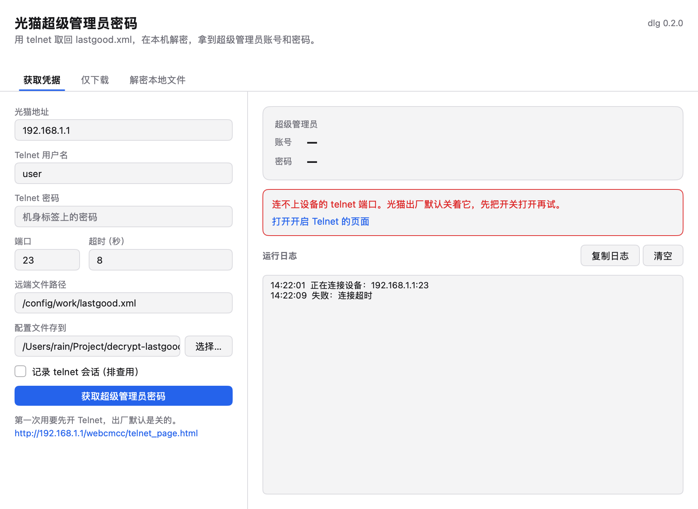
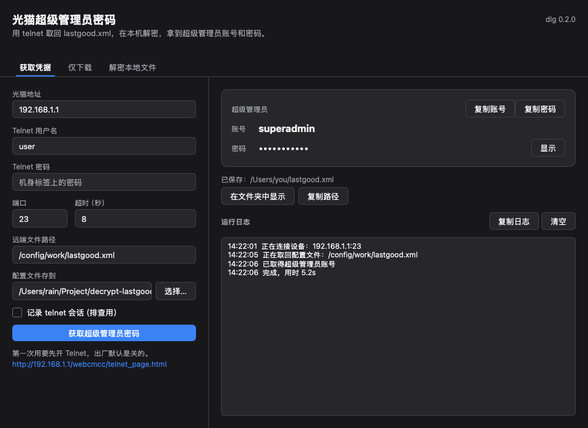

# 桌面客户端

`gui/` 是这个仓库的第二个前端：一个原生绘制的窗口客户端。取文件、解密、提取账号这三步和
命令行完全一样，只是不用记参数。



界面由 Go 直接画在 GPU 上（macOS 用 Metal，Windows 用 Direct3D 11，Linux 用
OpenGL），没有 webview、没有 HTML/JS、没有前端构建步骤，窗口打开就出画面，内存占用也小。
用的是 [MyGo](https://github.com/egoist/mygo) 的 `ui` 包。

## 和命令行是什么关系

一个 module，两个入口，一份实现：

```
cmd/dlg          命令行入口（参数、终端输出）
gui              桌面客户端（窗口）
        ↘       ↙
         pkg/dlg      取文件、解密、提取账号、写文件
        ↘       ↙
  internal/telnet   internal/container   internal/kdf
```

`pkg/dlg` 是这一层公共 API，命令行和窗口都调它，所以两边的步骤顺序、超时、错误判断、
`0600` 权限、Telnet 提示页地址不会各写一遍、也不会走偏。

MyGo 只有一个地方用得到：`gui`。它在 `go.mod` 里是模块依赖，但命令行的导入图里没有它——
`go list -deps ./cmd/dlg` 不会出现 `github.com/egoist/mygo`，所以编出来的 `dlg` 还是那个
不带第三方代码的静态二进制（3.0 MB）。CI 里有一条检查专门盯这个。

命令行那边的行为没变：默认命令、`download`、`decrypt`、参数、退出码、`-v` 记录都和 0.1.0
一致，`decrypt`/`download` 的输出文本也没动。

## 三个页面

窗口分左边参数、右边结果。上面三个标签对应命令行的三条路径：

| 页面 | 等价命令 | 做什么 |
| --- | --- | --- |
| 获取凭据 | `dlg <IP> -u user` | 连接、下载、解密、写 `lastgood.xml`、显示超管账号密码 |
| 仅下载 | `dlg download <IP> -u user` | 只把加密文件取回来 |
| 解密本地文件 | `dlg decrypt x.enc --show-cred` | 手上有加密文件时，本地解出账号密码 |

右栏从上到下是：账号卡片、当前状态、运行日志。

- 密码默认打码，点「显示」才明文；账号、密码、路径、日志都能一键复制。
- 失败时红框里写原因；连不上 telnet 端口时，框里直接给「打开开启 Telnet 的页面」链接。
- 日志按步骤记录（连接 → 取回 → 解密 → 保存）。勾上「记录 telnet 会话」就是命令行的
  `-v`，把原始收发也写进日志，用来排查固件差异。
- 连接、下载在后台 goroutine 跑，界面不卡；跑的时候表单和标签都锁住，避免两次运行抢同一个
  telnet 会话。
- `Enter` 提交当前表单，`Cmd+Enter`（Windows/Linux 是 `Ctrl+Enter`）在任何位置都能运行。
- 把 `.enc` 拖到窗口任意位置：自动切到「解密本地文件」并填好路径，省得再去点「选择…」。
- 窗口大小和位置会记住（`StateKey: "main"`）。



深色主题跟随系统：



## 编译与运行

整个仓库一个 module，工具链版本由 `go.mod` 定：Go 1.27.3 以上（MyGo 的要求）。窗口版的
依赖因此也进了模块，但只有 `gui` 这个包会链接它，命令行不受影响。

```bash
cd gui
go run .            # 开发时直接跑
go test ./gui       # 视图测试，不需要窗口，也不会连光猫（在仓库根目录跑）
```

打包成可分发的应用：

```bash
./build-gui.sh                                  # 当前平台
./build-gui.sh -platform darwin/universal,windows/amd64,linux/amd64
```

产物在 `gui/build/<os>-<arch>/`：macOS 是 `dlg.app` 和 `dlg-<版本>-arm64.dmg`，Windows 是
`dlg.exe` 和安装包（需要 NSIS，没装就跳过），Linux 是可执行文件加 `.deb` / `.rpm` /
`PKGBUILD`。macOS 上的签名默认是 ad-hoc，没有开发者证书时第一次打开要右键「打开」。

发版时 `.github/workflows/release.yml` 里的 `desktop` job 在 macOS runner 上跑上面这条命令，
把三个平台的产物分别压成 `dlg_gui_<版本>_<os>_<arch>.zip` 传上去；命令行的压缩包由另一个
job 出。

版本号只有一个来源：`pkg/dlg.Version`，命令行 `dlg version` 和窗口右上角都读它。发版时
另外把 `gui/mygo.json` 的 `version` 改成同一个值——那个文件是给打包器看的，Go 代码读不到。

## 视图怎么写的

`app` 是状态，`view` 是状态的函数，MyGo 在每次输入后重画一帧：

```go
func (a *app) view(c *ui.Context) {
	t := c.Theme()
	ui.Column(c).Fill().Children(func() {
		a.header(c, t)
		a.pages(c, t)
		ui.Row(c).Grow(1).AlignItems(ui.Stretch).Children(func() {
			a.form(c, t)    // 左：参数
			a.results(c, t) // 右：账号、状态、日志
		})
	})
}
```

几条约束，改代码时别踩：

- **元素不能存。** 构造函数返回的 `ui.Element` 只属于当前这一遍 build，存进 `app` 或者丢给
  goroutine 都会在下一帧失效。状态里只放数据（字符串、`dlg.Credential`、日志文本）。
- **状态从别的 goroutine 改，走 `Window.Update`。** 任务里用 `app.post(...)`，它在生产环境
  是 `win.Update`（主线程执行并重画），测试里直接同步执行——所以测试是确定性的，不用 sleep。
- **慢 IO 不上主线程。** telnet 会话、文件对话框都在 `app.spawn` 起的 goroutine 里跑。
- **文案在 view 里，不在库层堆。** `pkg/dlg` 只回中性的 `Stage`，怎么措辞由前端决定。

## 测试

窗口不开也能测。`ui.NewTester` 在内存里渲染，按文字找控件、点击、输入、按快捷键：

```bash
cd gui
go test ./...                          # 视图测试，不开窗口也不连光猫
go tool mygo vet .                     # 查把 build 值存进结构体/goroutine 的写法
```

覆盖：首帧内容、一次完整获取（含密码打码与「显示」）、复制到剪贴板、连接失败时给出 Telnet
页面并真的打开、其它错误只显示原文、表单校验（空地址、非数字端口）、仅下载、解密页缺文件、
`-v` 的会话记录进日志、日志截断保留尾部、运行期间锁住表单、Tab 聚焦 + 输入 + Enter 提交、
`Cmd+Enter`、拖入文件切页。

界面截图也是测试产出的，不需要开窗口：

```bash
cd gui
GUI_SNAPSHOT=/tmp/dlg go test . -run TestSnapshot
# /tmp/dlg-empty.png、-result.png、-hint.png、-error.png，各自的 -dark.png 是深色版
```

`docs/images/` 里的图就是这么来的。改了布局重新生成一遍，顺手更新 README 里的那张。

## 已知限制

- 运行中不能取消：telnet 客户端还没有接 context，最长要等到下载的 120 秒超时。关窗口会中断
  会话（goroutine 随进程结束），但没有「取消」按钮。
- 只做了简体中文，没接 MyGo 的 i18n。文案集中在 `gui/view.go` 和 `pkg/dlg` 的
  `DescribeStage`，要加语言的话从这两处拆。
- 大配置文件（几 MB 的 XML）解密后写盘在主线程之外，但读回内存是全量的；这个量级没问题，
  再大就该换流式处理。
